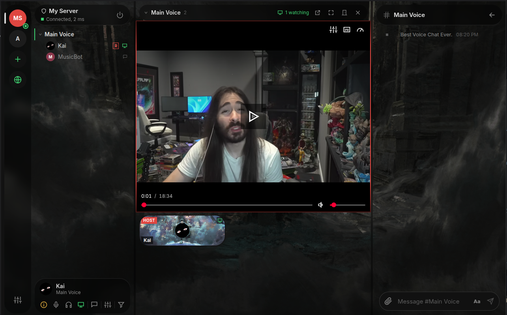
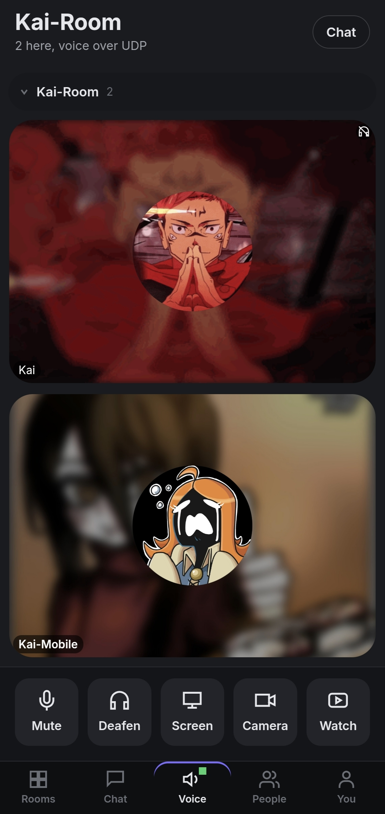
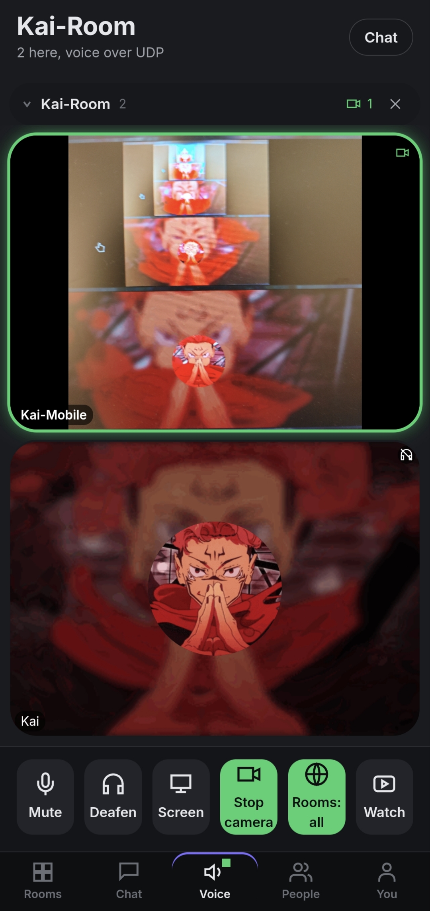
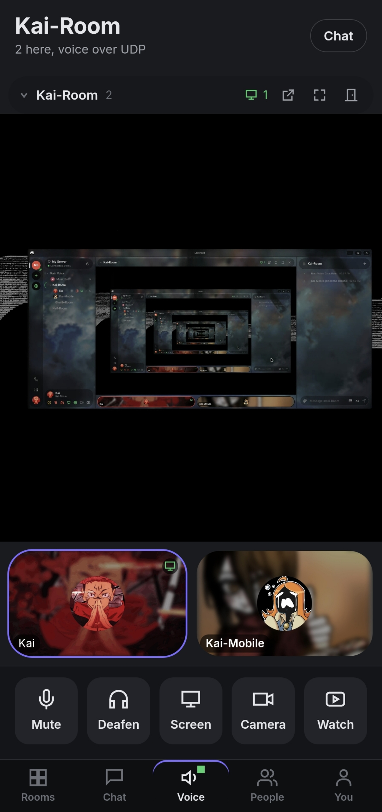
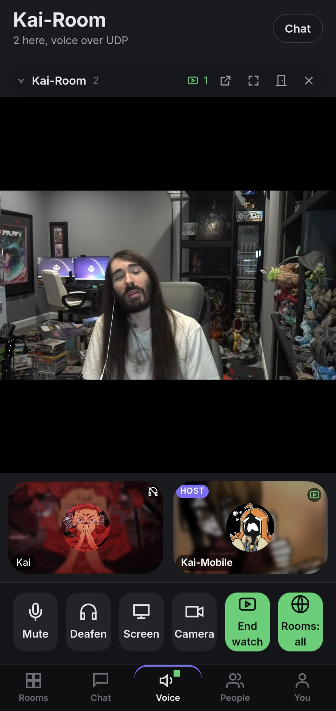
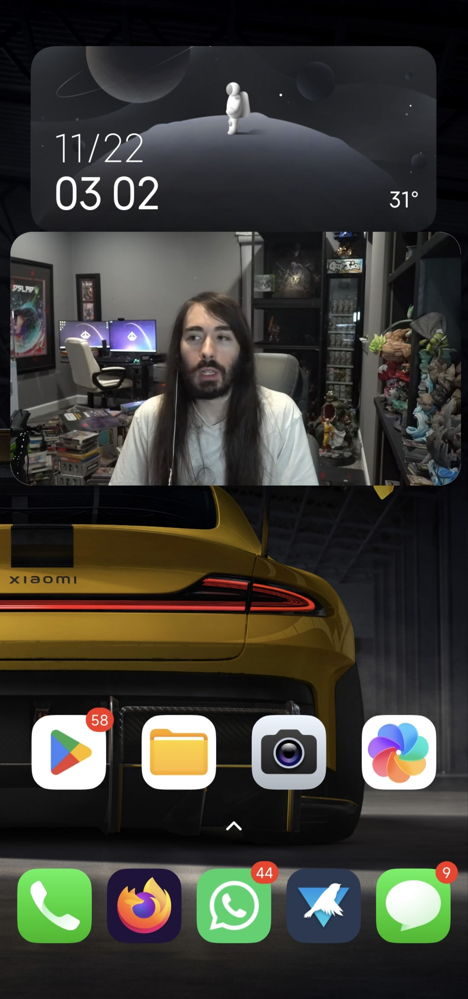

# Libertad

**Voice chat with your friends on Mumble, or call them privately without a server (HyperDHT).**

Libertad works with any Mumble server as it is: nothing has to be installed or changed on the server, and friends on the classic Mumble app still hear and see you like anyone else. It also has a server-less side: add friends by a code and call them directly, with no Mumble server at all. It runs on Windows and Linux, and an Android version is in development (see [Android](#android-under-development)).

https://github.com/user-attachments/assets/832434a1-2b63-4d36-b25f-2f67f1e0feed

## Why Libertad

- **Talk.** Clear, low-delay voice with push to talk, voice activity or always on. Three noise suppression engines (Speex, RNNoise, DeepFilterNet3), four ways to detect speech (down to Silero VAD), echo cancellation, and per-person volume up to 300%.
- **Chat like you are used to.** Messages, pictures, GIFs, files, link previews and YouTube cards, in every channel and in private. Rich text, `@name` and `@all` mentions, edit and delete your own messages.
- **Call friends directly.** Add a friend by their code and call them peer to peer, with chat, screen share, camera and Watch Together inside the call. No server, no account, no IP address to swap.
- **Share your screen or your camera** with the people in your channel, with per-viewer quality caps, stats for nerds, zoom and a save-frame button.
- **Watch with your friends**: YouTube, local files or torrents, in sync. Everyone controls playback, with subtitles and playback speed.
- **Send files**, up to 100 GB, straight from computer to computer through WebRTC. No upload sites.
- **Make it yours.** Seven color schemes (including Windows 95) or fully custom colors, backgrounds (picture, GIF or video), profile cards, rounded corners, transparency and blur. Two interfaces: Standard and Rooms.
- **No account, no tracking.** Your identity is a file on your computer, and chats load nothing from sites you did not choose.

## Share your screen

Pick a screen or a window, choose the quality and whether to send its sound, and everyone in your channel who uses Libertad can watch with one click, as large as they like or in a window of its own.


## Watch Together

Host a YouTube session (with search), a local file session, or paste a torrent link. Everyone can pause, resume and seek.



## Friends and private calls

Open **Friends** on the start screen, choose **View Code**, and send your code to someone. They paste it into **Add a Friend**, you accept, and you can see when each other is online and call with one click.

- **Peer to peer.** Runs over [HyperDHT](https://github.com/holepunchto/hyperdht), encrypted end to end between your identity keys. No IP addresses, and no server stores anything.
- **One identity, one code.** The same identity gives the same code on any computer. Back it up.
- **Strangers can only send a request.** Declining blocks that code, and you can turn requests off completely.
- **Inside a call:** mute and deafen, a call chat, screen share, camera and Watch Together, each draggable into its own window.

## Get started

1. **Download Libertad** from the [releases page](https://github.com/DarknessIV4/Libertad/releases) and install it (the AppImage might require fuse2).
2. **Create your identity** on the first start, or keep your existing Mumble desktop identity with all its registrations.
3. **Add a server** with the plus button, using the address your friends gave you, or pick one from the public server list.

| System | File |
|---|---|
| Windows | `Libertad-win.exe` (installer; not signed yet, so SmartScreen warns once) |
| Linux, any distribution | `Libertad-x86_64.AppImage` (make it executable, then run it) |
| Debian, Ubuntu | `Libertad-amd64.deb` |
| Linux, portable | `Libertad-x64.tar.gz` (includes `install.sh` and `uninstall.sh`) |
| Android | `Libertad.apk` (under development) |

Settings and identities live in `~/.config/Libertad`; back up your identity before uninstalling. There is no macOS build yet; it can be built on a Mac from source.

## Android (under development)

The Android version is **still under development**. It is the same app in a Capacitor WebView with a Node backend. Right now it supports:

- **Mumble servers only.** Friends, private calls, file sharing and torrents are not on Android yet.
- **Screen share: watching only.** You can watch someone's screen, but not share your phone's screen yet.
- **Camera** sharing from the phone.
- **YouTube Watch Together**, in sync with everyone in the room.
- **Picture-in-picture**: a camera, share or video keeps playing in a small window when you leave the app, and the connection stays alive in the background.

| Rooms interface | Camera | Watching a screen share | YouTube Watch Together | Picture-in-picture |
|:---:|:---:|:---:|:---:|:---:|
|  |  |  |  |  |

There is no Android release yet. To try it, build it yourself (see [Building](#building)); this needs **JDK 21**. It is a debug build for sideloading and has only been tried on a few devices. See [`mobile/README.md`](mobile/README.md) for how it works and what is untested.

## Everything else it does

<details>
<summary><b>Voice and audio</b></summary>

- Transmit modes: voice activity, push to talk, always on. Detectors: standard, noise gate, RNNoise probability, Silero VAD.
- Noise suppression: Speex (lightest), RNNoise (medium), DeepFilterNet3 (heaviest), each with its own strength.
- Bitrate and audio per packet, microphone test, level meter, quick audio popover.
- Deafen for me, mute for me, per-person volume (0 to 300%), and local nicknames.
- Force TCP voice when UDP is blocked. About 45 notification sounds, each replaceable, or import a TeamSpeak 3 sound pack.

</details>

<details>
<summary><b>Chat</b></summary>

- Rich text, mentions with autocomplete, edit or delete your own messages.
- Images, GIFs (built-in search), videos, audio and files, with previews. Link previews (off by default) and click-to-play YouTube cards.
- **Text channels** between Libertad users: read and write without joining the voice channel.
- **Quick message:** send a message to a saved server without opening it.

</details>

<details>
<summary><b>Screen share, camera and Watch Together</b></summary>

- Screen, window or camera as the source, with sound from one program or the whole system (Linux: PipeWire).
- Host limits for bitrate, height and FPS; viewers can lower their own further. Hardware encoding when your GPU has an encoder.
- Watch several shares at once, pop any stream into its own window, zoom, save the current frame.
- Watch Together sources: YouTube (search and sign-in), local files, torrents (Torrentio search, magnet links, queues). Files the browser can not play are converted on the fly with ffmpeg.
- Subtitles from OpenSubtitles, playback speed, and a memo of the last shows watched.

</details>

<details>
<summary><b>Servers, channels and admins</b></summary>

- Saved servers with icons, live user counts and ping, a public server list, and per-server identity and password.
- Drag channels around, link them, set text-channel mode, edit permissions and ACLs.
- **Admin role** (Libertad users only): the SuperUser can let registered users create, move and delete channels, and move, mute or deafen people.
- Register users, kick, ban, priority speaker, server mute and deafen.

</details>

<details>
<summary><b>The desktop app</b></summary>

- Tray icon with live status, close-to-tray, system-wide shortcuts (not on every Wayland desktop), run on startup.
- Hardware acceleration and GPU choice, X11 or Wayland selection on Linux.
- Auto-update with progress (Windows installer and AppImage).
- Identities: create, import, back up with a password, or reuse your Mumble desktop identity.

</details>

## Good to know

- **It is still Mumble.** Any Mumble server works, and people on other Mumble apps share the same channels and chats.
- **Some extras only work between Libertad users:** screen and camera sharing, Watch Together, text channels, profile backgrounds, `@all` mentions and players for shared files. Everyone else sees a normal channel, a normal link, or nothing.
- **Not in Libertad yet:** push to talk while in the background, whisper and shout, positional audio, the in-game overlay, recording, and the ban list and registered-user editors.
- **Back up your identity.** It is how servers recognize you.

### STUN and relay

Screen sharing and file transfers connect you directly to the other side (WebRTC). In **Settings, Voice**:

- **STUN server:** needed across the internet to find a route. It learns your IP but never sees the stream. With none selected, streams only work on the same network.
- **Relay (optional):** a Libertad relay server used when a direct connection is not possible (mobile data, strict networks). Its operator sees your IP and carries the stream, but cannot watch it.

### File transfers

Files go directly between Libertad users over encrypted WebRTC, with no file host. If no direct connection is possible, the pieces travel through the Mumble server as chat messages (about 200 KB/s on default server limits). Anyone who has a file can send it, so downloads keep working after the original sender leaves. Files are checked against the hash in the announcement, and each computer keeps up to 100 GB, oldest out first.

### Privacy and security

- Your identity is a certificate that stays on your computer, stored with owner-only permissions.
- Server certificates are pinned on first connect; if one changes, Libertad stops before sending your password.
- Chats don't phone home: media is only loaded from hosts you add, and YouTube players are off by default.
- Strict content security policy, and all message HTML is sanitized.

### Roadmap

- Finish the Android version: friends, calls, file sharing and sharing the phone screen
- System-wide push to talk and whisper/shout
- Rich chat between Libertad users: replies, reactions, typing indicators
- Better file sharing and screen sharing (every extra viewer currently splits your upload)
- Group calls and chats independent from Mumble servers
- More polish and quality-of-life improvements

## For developers

You need [Node.js](https://nodejs.org/) 22 or newer and git.

```bash
git clone https://github.com/DarknessIV4/Libertad.git
cd Libertad
npm install
npm run dev          # app with hot reload
npm run check        # type check
npm test             # unit tests
```

### Building

Start from a clean tree for each target, since the three builds use different native dependencies.

**Linux** (AppImage, .deb and .tar.gz):

```bash
rm -rf node_modules dist dist-electron release
npm install --foreground-scripts
npm run dist:linux
```

**Android** (needs **JDK 21** and the Android SDK):

```bash
rm -rf node_modules dist-android
npm install --foreground-scripts --allow-remote=root   # --allow-remote lets npm fetch the capacitor-nodejs plugin
ln -sf ../vite/bin/vite.js node_modules/.bin/vite
export JAVA_HOME=/usr/lib/jvm/java-21-openjdk          # path differs per distro (Debian/Ubuntu: java-21-openjdk-amd64)
export PATH=$JAVA_HOME/bin:$PATH                       # fish: set -x JAVA_HOME ...; set -x PATH $JAVA_HOME/bin $PATH
npm run build:android                                  # builds the app and the APK: release/Libertad-<version>-android.apk
npx cap run android                                    # optional: install and run it on a connected phone or emulator
```

`npm run build:android` prepares the page, the Node backend and the native files, then runs Gradle. Gradle only rebuilds what changed, so running it again after an edit is quick. If it stops with `Unsupported class file major version`, or says it needs JDK 21, set `JAVA_HOME` as above in the same terminal.

**Windows installer, built on Linux** (needs Wine):

```bash
rm -rf node_modules dist dist-electron release
npm_config_platform=win32 npm_config_arch=x64 npm install --foreground-scripts
npm run dist:win
```

macOS: `npm run dist:mac` on a Mac.

See [CLAUDE.md](CLAUDE.md) for the architecture and project conventions.

```
electron/   main process: window, TLS sockets, identities, tray
src/core/   Mumble protocol: framing, codec, client state, voice packets
src/lib/    app state, voice engine, sanitizing, file transfers
src/ui/     Svelte components
mobile/     Android backend (nodejs-mobile) and native Java parts
proto/      Mumble.proto and MumbleUDP.proto from upstream
test/       unit, server and end-to-end tests
```

---

## AI disclosure and credits

Libertad is built by **Kibi** together with **Claude**, Anthropic's AI model, working in Claude Code. Kibi decides what Libertad should be and whether a result is good enough. Claude writes most of the code, the tests and this documentation. Commits written with Claude carry a `Co-Authored-By: Claude` line.

The Windows version, the .deb and the Android app have not been tested thoroughly; I mainly tested on my Arch machine.

## License

[MIT](LICENSE). The Mumble protocol definitions in `proto/`, and the code generated from them, are licensed by The Mumble Developers under a BSD license; see [THIRD_PARTY_NOTICES.md](THIRD_PARTY_NOTICES.md).

Libertad is not affiliated with the Mumble project. Mumble is a trademark of its respective owners.
