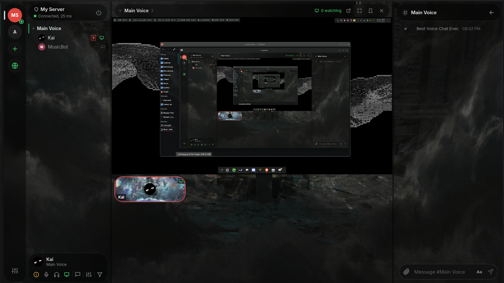
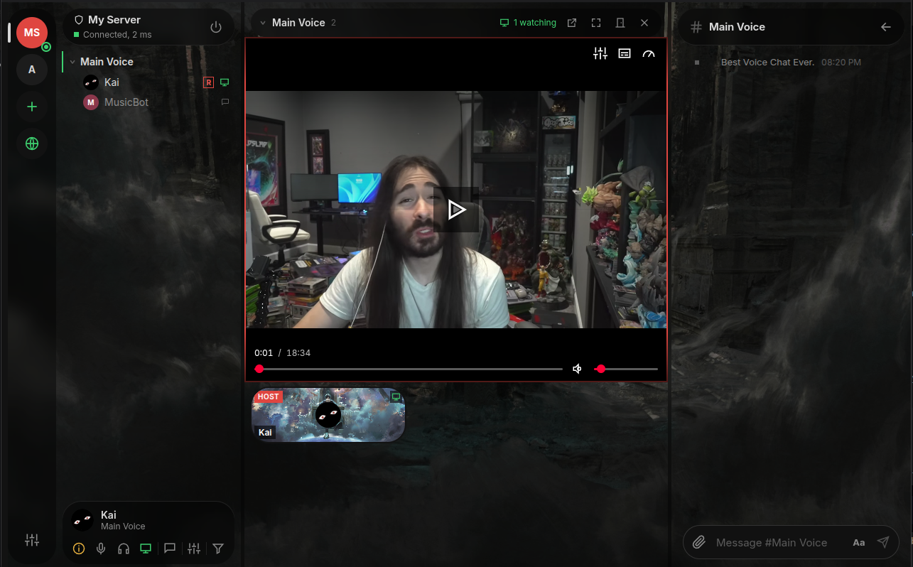
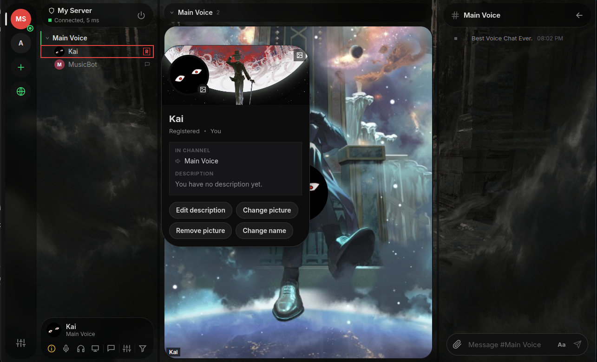
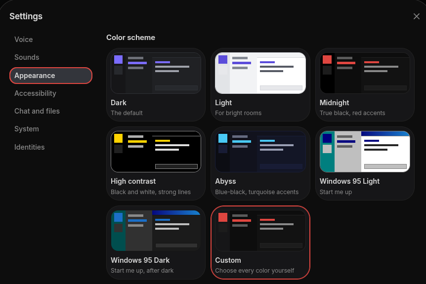
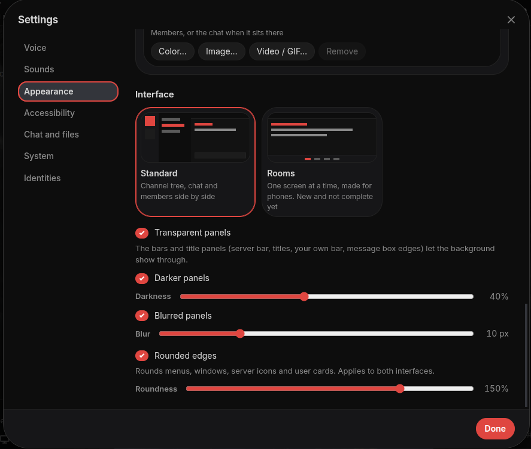

# mumh5

**Voice chat with your friends on Mumble, in an app that feels like the chat apps you already know.**

mumh5 works with any Mumble server, as it is: nothing has to be installed or changed on the server, and friends on the classic Mumble app still hear and see you like anyone else. It runs on Windows and Linux, and in a browser.


## Why mumh5

- **Talk.** Clear, low-delay voice, with push to talk, voice activity or always on, and noise suppression.
- **Chat like you are used to.** Messages, pictures, files, link previews and YouTube cards, in every channel and in private.
- **Share your screen or your camera** with the people in your channel.
- **Send files**, up to 100 GB, through WebRTC. No upload sites.
- **See who is who.** Profile pictures and profile cards, and banners.
- **Make it yours.** Custom Color schemes to your liking, add background image or video,cahnge how corners look, and control trasnparecny, darkness, and blur effects.
- **No account, no tracking.** Your identity is a file on your computer; chats load nothing from sites you did not choose, Unless you choose to login with your youtbe account in settings.

## Share your screen

Stream a game, show a bug, watch something together. Pick a screen or a window, choose the quality and whether to send its sound, and everyone in your channel who uses mumh5 can watch with one click, as large as they like or in a window of its own.



## Watch Together

Host a youtube watch together session "supprots search", a file watch together session, or even past a torrent link to start a session, evetyone can control the playback of the video, pause, resume, and seek.



## Get started

1. **Download mumh5** from the [releases page](https://github.com/DarknessIV4/mumh5/releases) and install it for your system (appimage might require fuse2, if you don't have it already).
2. **Create your identity.** mumh5 asks for it on the first start: give it a name and it is made, or, if you used Mumble on this computer before, keep that one with all your registrations.
3. **Add a server** with the plus button, using the address your friends gave you, or find one in the public server list (desktop app).

| System | File |
|---|---|
| Windows | `mumh5-win.exe` (installer; not signed yet, so Windows SmartScreen warns once) |
| Linux, any distribution | `mumh5-x86_64.AppImage` (make it executable, then run it) |
| Debian, Ubuntu | `mumh5-amd64.deb` |
| Linux, portable | `mumh5-x64.tar.gz` (runs from its folder, or installs with the script inside) |

The `.tar.gz` comes with an installer and an uninstaller. Unpack it and run the installer from that folder; it adds the app, a `mumh5` command and a menu entry, and running it again with a newer version updates it:

To remove it, run `uninstall.sh`. Your settings and identities stay in `~/.config/mumh5`; `uninstall.sh --purge` deletes them too, after asking. Back up your identity first. The Windows installer has its own uninstaller in the system settings; the `.deb` is removed with `sudo apt remove mumh5`.

There is no macOS build yet; it can be built on a Mac from the source (see [For developers](#for-developers)).

## A look around

| Profile cards |
|---|---|
|  |

Pick a color scheme, or Customize it yourself:

| Windows 95 | Light | Midnight | Custom |
|---|---|---|---|
|  |  |

## Good to know

- **It is still Mumble.** Any Mumble server works, and people on other Mumble apps are part of the same channels and chats.
- **A few extras only work between mumh5 users**, because Mumble itself has no such thing: screen and camera sharing, text channels, and players for shared files. Everyone else sees a normal channel, a normal link, or nothing.
- **Not in mumh5 yet:** push to talk while mumh5 is in the background, whisper and shout, positional audio, the in-game overlay, recording, and the ban list and registered-user editors. The Mumble desktop app has these.
- **Back up your identity.** It is how servers recognize you. mumh5 offers a password-protected backup right after you create it, and in Settings, Identities.

mumh5 also runs in a browser. Browsers cannot open the TLS connection Mumble uses or present a client certificate, so a small proxy you host yourself does that part: it serves the web app and bridges each browser connection to a Mumble server.

```bash
npm ci
npm run build:web      # web app to dist-web/, proxy to dist-proxy/proxy.mjs
MUMH5_SERVERS="mumble.example.com=My server" node dist-proxy/proxy.mjs
```

Then open `http://127.0.0.1:8080`. For development, `npm run dev:web` starts the proxy and a hot-reloading page together, with any server allowed. To deploy, copy `dist-web/` and `dist-proxy/` next to each other on the server (Node 22 or newer, no `node_modules` needed) and put a reverse proxy with HTTPS in front that forwards WebSocket upgrades. Browsers only allow the microphone on HTTPS pages (or on localhost).

With Docker, the same thing is one command; settings go in a `.env` file next to `docker-compose.yml`:

```bash
echo 'MUMH5_SERVERS=mumble.example.com=My server' > .env
docker compose up -d --build
```

The container uses the host's network: the proxy listens on `127.0.0.1:8080` for your reverse proxy, and a Mumble server on the same machine is reachable as `localhost`.

For screen sharing, open these in the firewall (and forward them on a router in front of the server): port 3478 for UDP and TCP, and UDP 49160-49659. They carry STUN and the relay, which the browser version uses without any setting. Relayed streams pass through your server and use its bandwidth, a few Mbit/s per viewer; anyone who knows the site's address can get credentials for it (the desktop app asks from outside the site), limited by connection quotas per address; there is no bandwidth cap yet.

| Variable | Default | Meaning |
| --- | --- | --- |
| `MUMH5_SERVERS` | none | Mumble servers people may connect to: `host[:port][=Label]`, comma-separated. Required unless `MUMH5_ALLOW_ANY=1` |
| `MUMH5_ALLOW_ANY` | off | Allow any server on the public internet. Private and loopback addresses stay blocked, except servers listed in `MUMH5_SERVERS` (for a Mumble server on the same machine: `MUMH5_SERVERS=localhost`), or all of them with `MUMH5_ALLOW_PRIVATE=1` |
| `MUMH5_PORT`, `MUMH5_BIND` | `8080`, `127.0.0.1` | Where the proxy listens |
| `MUMH5_ORIGINS` | same host | Origins allowed to use the API, comma-separated, when the page is hosted elsewhere |
| `MUMH5_TRUST_PROXY` | off | Take client addresses from `X-Forwarded-For` (set this behind a reverse proxy) |
| `MUMH5_SEND_PROXY` | off | Announce each visitor's address to the server with the PROXY protocol (see below). Breaks connections to a plain Mumble server |
| `MUMH5_STUN_PORT`, `MUMH5_STUN_BIND` | `3478`, all addresses | Port for screen sharing between browser users: STUN over UDP, and the relay over UDP and TCP. Browsers reach it directly, not through nginx. `0` turns both off |
| `MUMH5_TURN` | on | The relay (TURN) for people who cannot connect directly: mobile networks, strict company networks, browsers that forbid direct UDP such as Vanadium. `0` leaves only STUN |
| `MUMH5_TURN_PORTS` | `49160-49659` | UDP ports the relayed streams use, one per relayed route |
| `MUMH5_TURN_URLS` | none | Extra relay addresses handed to clients, comma-separated, for example `turns:turn.example.com:443?transport=tcp` when a TLS front forwards to port 3478. For networks that only let port 443 out |
| `MUMH5_DEBUG` | off | Log relay events (credentials handed out, routes granted or refused) |
| `MUMH5_TURN_MAX`, `MUMH5_TURN_PER_ADDRESS` | `500`, `64` | Relayed routes in total and per client address. A camera round uses several per person |
| `MUMH5_TURN_IP` | found automatically | The server's public address, announced for relayed streams. Set it when the server sits behind a 1:1 NAT, as on many cloud hosts |
| `MUMH5_STATIC` | `../dist-web` | Folder with the web build |
| `MUMH5_MAX_CONNECTIONS`, `MUMH5_MAX_PER_ADDRESS` | `200`, `8` | Connection limits, in total and per client address |

Example for nginx. `Host` must be passed on unchanged, because the proxy only accepts requests whose origin matches it. `X-Forwarded-For` carries the visitor's address; start the proxy with `MUMH5_TRUST_PROXY=1` so its per-address limits use it.

```nginx
map $http_upgrade $connection_upgrade { default upgrade; '' close; }

server {
    listen 443 ssl;
    server_name voice.example.com;
    # ssl_certificate and ssl_certificate_key go here

    location / {
        proxy_pass http://127.0.0.1:8080;
        proxy_http_version 1.1;
        proxy_set_header Host $http_host;
        proxy_set_header X-Forwarded-For $remote_addr;
        proxy_set_header Upgrade $http_upgrade;
        proxy_set_header Connection $connection_upgrade;
        proxy_read_timeout 1h;
        proxy_send_timeout 1h;
        proxy_buffering off;
    }
}
```

By default the Mumble server sees every browser user coming from the proxy's address, and that is the address other people and admins get in a user's information. No nginx setting changes that. Bans by IP on the Mumble server would then hit all users of the proxy; ban by certificate instead. In your own information mumh5 shows the address the proxy saw for you, next to the one the server sees.

#### Showing the Mumble server the visitor's real address

Mumble does not understand the PROXY protocol ([mumble#4769](https://github.com/mumble-voip/mumble/issues/4769)), so the only way is to make the connection to it really come from the visitor's address. [go-mmproxy](https://github.com/path-network/go-mmproxy) does this on Linux: it accepts a connection that starts with a PROXY line and opens the connection to the server with that address as the source. It has to run on the same machine as the Mumble server, as root or with `CAP_NET_ADMIN`, with routing rules that send the server's replies back to it:

```bash
# on the Mumble server's machine
ip rule add from 127.0.0.1/8 iif lo table 123
ip route add local 0.0.0.0/0 dev lo table 123
ip -6 rule add from ::1/128 iif lo table 123
ip -6 route add local ::/0 dev lo table 123
go-mmproxy -l 127.0.0.1:64750 -4 127.0.0.1:64738 -6 "[::1]:64738"

# the mumh5 proxy then connects to go-mmproxy instead of Mumble
MUMH5_SEND_PROXY=1 MUMH5_TRUST_PROXY=1 MUMH5_SERVERS="127.0.0.1:64750=My server" node dist-proxy/proxy.mjs
```

The routing rules and options are go-mmproxy's; check its README for your system. mumh5's side (sending the PROXY line) is covered by tests, the go-mmproxy setup itself has not been tested with mumh5. People on the desktop client keep connecting to Mumble directly.

What is different from the desktop app:

- **The proxy is trusted.** Your certificate and its private key are kept in the browser's storage and sent to the proxy on every connect, and everything you send, including the server password, passes through it. Whoever runs the proxy could act as you. Use a proxy you run yourself or trust.
- **Voice goes over TCP.** Browsers have no UDP sockets, so voice uses Mumble's TCP tunnel through the proxy. It works, with more delay on lossy connections.
- **Clearing the browser's data removes your identity.** Download a backup; the same `.p12` file works in the desktop app and in Mumble.
- **Not available:** the public server browser, link previews fetched by your own computer, the tray icon, importing the desktop Mumble certificate automatically.
- Voice uses the browser's own audio codec where there is one, and a built-in one otherwise (Firefox on Android). Both are tested in Chromium only.

</details>

<details>
<summary><b>How file sharing works</b></summary>

Files travel through the Mumble server, to other mumh5 users. There is no file host and nothing is stored on the server.

- A file is announced in the chat with its name, size and a preview picture. Regular Mumble users see that and nothing more.
- mumh5 users fetch it with one click, or by themselves when it is small (20 MB by default, Settings, Chat and files). Small pictures are sent inline as they are, so everyone sees them.
- The pieces are chat messages addressed only to the people downloading. Murmur allows about one message a second per user, but a message may be as long as the server's image limit (128 KB of text by default), and mumh5 packs 15 bits into every character. On a server with default limits that is about 200 KB/s, or 12 MB a minute, from each person sending. One message reaches every downloader at once, so ten people fetching the same file cost the sender no more than one.
- Anyone who has a file can send it, not only the person who posted it. A download asks everyone online who has it and splits the pieces between up to four of them (the server limits each sender separately), so it keeps working after the sender has left.
- Each computer keeps the files it sent and received, up to 100 GB, oldest out first. Files are checked against the hash in the announcement.
- Large files (256 MB and up) ask where to save when you click Download, before anything is fetched, and are written straight into that file, so they are not stored twice. A part file named `<name>.mumh5part` sits beside it until the download is complete and checked, and is deleted if the download stops or fails. Because they are not kept in the app's storage, other people cannot fetch them from you afterwards. A large file you send is sent from where it is and not copied into the app's storage either.
- Your own chat messages always go out first; files use what is left of the server's message limit.

Servers can raise the limits for faster transfers: `imagemessagelength` (larger pieces, 0 for no limit) and `messagelimit` / `messageburst` in the server's configuration. Needs Mumble 1.4 or newer on the server. Sending a large file uses your upload bandwidth; on a slow line, voice over the TCP tunnel (as in the browser version) can lag while it runs.

</details>

### Privacy and security

- **Your identity is a certificate** that stays on your computer, stored with owner-only permissions. mumh5 reminds you to back it up. (The browser version is different, see above.)
- **Server certificates are pinned** the first time you connect. If one changes, mumh5 stops before sending your password and asks you.
- **Chats don't phone home.** Files come through the Mumble server; media links are only loaded from hosts you add yourself. YouTube players are off by default and click-to-play in privacy mode when enabled.
- **Strict content security policy** in the app, and all message HTML is sanitized.

### Roadmap

- System-wide push to talk
- Whisper and shout
- Text channels: private ones, and history while nobody is online (needs a helper on the server)
- Rooms interface: moving channels and people without dragging, gestures, more polish
- Rich chat between mumh5 users: replies, reactions, edits, typing indicators
- Screen sharing: a media server for large rounds (today every sender uploads once per viewer, up to 8)
- Release builds for all platforms

## For developers

### Running from source

You need [Node.js](https://nodejs.org/) 22 or newer and git.

```bash
git clone https://github.com/DarknessIV4/mumh5.git
cd mumh5
npm install
npm run dev
```

To install what you built, with a `mumh5` command and a menu entry, run `build/linux/install.sh` from the checkout (Linux). It builds the app and installs it in `~/.local`; run it again after pulling to update.

On first start, mumh5 asks you to set up your identity. If you already use Mumble on this computer, pick "Use my Mumble desktop identity" to keep your registrations. Then add a server with the plus button.

### Building installers

```bash
npm run dist:linux   # AppImage, .deb and .tar.gz (with install.sh and uninstall.sh from build/linux)
npm run dist:win     # NSIS installer
npm run dist:mac     # .dmg
```

Installers are written to `release/`. The Windows installer also builds on Linux with Wine installed; the macOS one needs a Mac. Pushing a version tag (`git tag v0.2.0 && git push origin v0.2.0`) makes the Gitea workflow in `.gitea/workflows/release.yml` build the Linux and Windows files and attach them to a release.

### Development

```bash
npm run dev          # app with hot reload
npm run check        # type check
npm test             # unit tests
```

Tests against a real Mumble server, including an end-to-end test that drives the app:

```bash
docker run -d --name mumh5-test-murmur -p 64739:64738 -p 64739:64738/udp \
  -e MUMBLE_CONFIG_AUTOBANATTEMPTS=0 -e MUMBLE_SUPERUSER_PASSWORD=testsuper mumblevoip/mumble-server
MUMBLE_TEST_HOST=localhost:64739 npm test
npm run build
MUMBLE_TEST_HOST=localhost:64739 MUMBLE_SUPERUSER_PASSWORD=testsuper npm run test:e2e
npm run build:web && MUMBLE_TEST_HOST=localhost:64739 npm run test:e2e:web   # browser build through the proxy
```

On Linux the end-to-end test forces X11, so it can run on a virtual display: `Xvfb :99 & DISPLAY=:99 npm run test:e2e`. See [CLAUDE.md](CLAUDE.md) for the architecture and project conventions.

```
electron/   main process: window, TLS sockets, identities, tray
src/core/   Mumble protocol: framing, codec, client state, voice packets
src/lib/    app state, voice engine, sanitizing, file transfers
src/ui/     Svelte components
proto/      Mumble.proto and MumbleUDP.proto from upstream
test/       unit, server and end-to-end tests
```

---

## AI disclosure and credits

mumh5 is built by **Kibi** together with **Claude**, Anthropic's AI model, working in Claude Code. Kibi decides what mumh5 should be and whether a result is good enough. Claude writes most of the code, the tests and this documentation. Commits written with Claude carry a `Co-Authored-By: Claude` line.

Windows version, deb, has not been testes thoroughly, i mainly tested on my Arch machine.

## License

[MIT](LICENSE). The Mumble protocol definitions in `proto/`, and the code generated from them, are licensed by The Mumble Developers under a BSD license; see [THIRD_PARTY_NOTICES.md](THIRD_PARTY_NOTICES.md).

mumh5 is not affiliated with the Mumble project. Mumble is a trademark of its respective owners.
