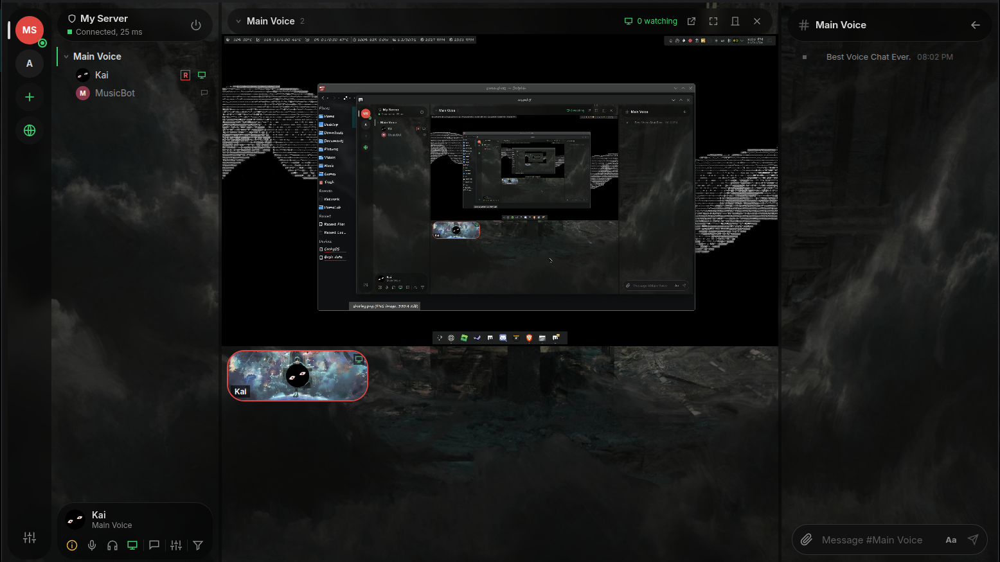
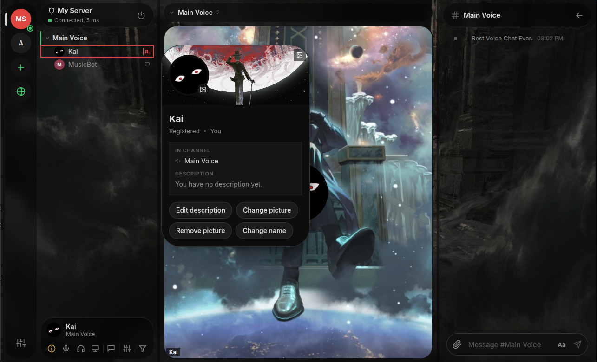
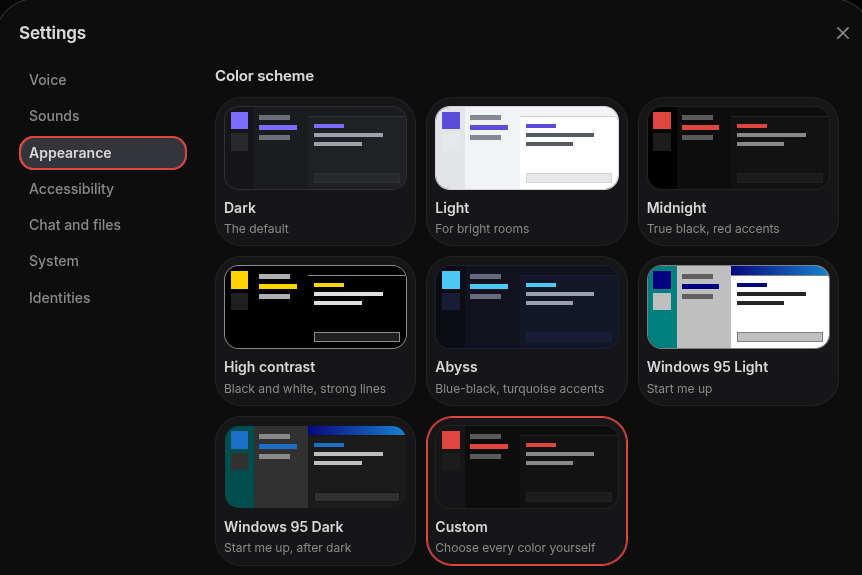
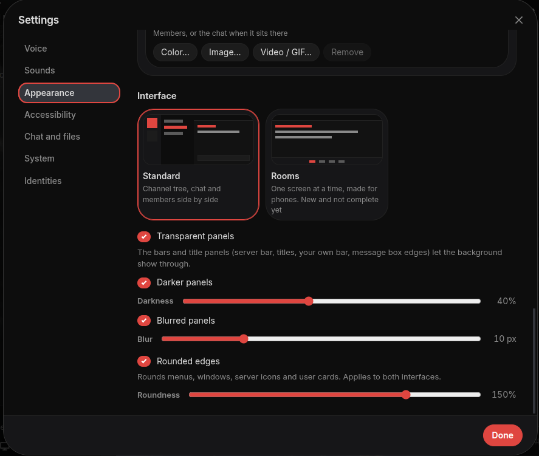

# Libertad

**Voice chat with your friends on Mumble, Or privately call them without a server (HyperDHT).**

Libertad works with any Mumble server, as it is: nothing has to be installed or changed on the server, and friends on the classic Mumble app still hear and see you like anyone else. It also has a server-less side: add friends by a code and call them directly, with no Mumble server at all. It runs on Windows and Linux.

https://github.com/user-attachments/assets/832434a1-2b63-4d36-b25f-2f67f1e0feed

## Why Libertad

- **Talk.** Clear, low-delay voice with push to talk, voice activity or always on. Three noise suppression engines (Speex, RNNoise, DeepFilterNet3), four ways to detect speech (down to Silero VAD), echo cancellation, and per-person volume up to 300%.
- **Chat like you are used to.** Messages, pictures, GIFs, files, link previews and YouTube cards, in every channel and in private. Rich text, `@name` and `@all` mentions, edit and delete your own messages, and half-typed messages survive the window being hidden.
- **Call friends directly.** Add a friend by their code and call them peer to peer, with chat, screen share, camera and Watch Together inside the call. No server, no account, no IP address to swap.
- **Share your screen or your camera** with the people in your channel, with per-viewer quality caps, stats for nerds, zoom, and a save-frame button.
- **Watch with your friends**: YouTube, local files or torrents, in sync. Everyone controls playback live, with subtitles, playback speed and a memo of what you watched last.
- **Send files**, up to 100 GB, straight from computer to computer through WebRTC. No upload sites.
- **See who is who.** Profile pictures, banners and profile cards (pictures, GIFs or video), with a live preview while you crop.
- **Make it yours.** Seven color schemes (including Windows 95) or fully custom colors, a background image, GIF or video, adjustable rounded corners, and transparency, darkness and blur for windows, buttons and panels. Two interfaces: Standard and Rooms.
- **Know what is happening.** About 45 notification sounds you can replace one by one or with a whole TeamSpeak sound pack, plus a tray icon that shows whether you are talking, muted or deafened.
- **No account, no tracking.** Your identity is a file on your computer; chats load nothing from sites you did not choose, unless you choose to log in with your YouTube account in settings.

## Share your screen

Stream a game, show a bug, watch something together. Pick a screen or a window, choose the quality and whether to send its sound, and everyone in your channel who uses Libertad can watch with one click, as large as they like or in a window of its own.



## Watch Together

Host a YouTube Watch Together session (it supports search), a file Watch Together session, or even paste a torrent link to start a session. Everyone can control the playback of the video: pause, resume, and seek.


## Friends and private calls

Libertad has a friend network that does not touch Mumble at all. Open **Friends** on the start screen, choose **View Code**, and send your friend code to someone; they paste it into **Add a Friend**, you accept, and you can see when each other is online and call with one click.

- **Peer to peer.** Friends and calls run over [HyperDHT](https://github.com/holepunchto/hyperdht), encrypted end to end between your identity keys. Nobody needs to know an IP address, and no server stores anything.
- **One identity, one code.** Your code comes from your identity, so the same identity gives the same code on any computer. Back it up.
- **Only requests from strangers.** Someone who is not your friend can send a request and nothing else. Declining blocks that code. You can turn requests off completely.
- **Add someone you meet on a server.** Open their profile card and press the friend request button.
- **Inside a call:** mute and deafen, a call chat (bubbles, lines or compact, with GIFs; messages are kept only until the call ends), and **screen share, camera and Watch Together**, the same ones as in a channel. Each can be dragged out into its own window.
- **Friend profiles.** Pictures, banners and descriptions are exchanged between friends and kept on your computer, so they show even while the friend is offline.
- **Online on Startup** makes you reachable as soon as the app starts. Go offline any time.

## Get started

1. **Download Libertad** from the [releases page](https://github.com/DarknessIV4/Libertad/releases) and install it for your system (the AppImage might require fuse2, if you don't have it already).
2. **Create your identity.** Libertad asks for it on the first start: give it a name and it is made, or, if you used Mumble on this computer before, keep that one with all your registrations.
3. **Add a server** with the plus button, using the address your friends gave you, or find one in the public server list (desktop app).

| System | File |
|---|---|
| Windows | `Libertad-win.exe` (installer; not signed yet, so Windows SmartScreen warns once) |
| Linux, any distribution | `Libertad-x86_64.AppImage` (make it executable, then run it) |
| Debian, Ubuntu | `Libertad-amd64.deb` |
| Linux, portable | `Libertad-x64.tar.gz` (runs from its folder, or installs with the script inside) |

The `.tar.gz` comes with an installer and an uninstaller. Unpack it and run the installer from that folder; it adds the app, a `Libertad` command and a menu entry, and running it again with a newer version updates it:

To remove it, run `uninstall.sh`. Your settings and identities stay in `~/.config/Libertad`; `uninstall.sh --purge` deletes them too, after asking. Back up your identity first. The Windows installer has its own uninstaller in the system settings; the `.deb` is removed with `sudo apt remove Libertad`.

There is no macOS build yet; it can be built on a Mac from the source (see [For developers](#for-developers)).

## A look around

|  |

Pick a color scheme, or customize it yourself:

| Custom Colors | Custom Settings |
|---|---|
|  |  |

## Everything else it does

<details>
<summary><b>Voice and audio</b></summary>

- Transmit modes: voice activity, push to talk, always on. Detectors: standard, noise gate, RNNoise probability, Silero VAD.
- Noise suppression engines: Speex (lightest), RNNoise (medium), DeepFilterNet3 (heaviest), each with its own strength.
- Bitrate and audio-per-packet (10 to 60 ms), a microphone test, an input level meter, and a quick audio popover from the user bar.
- **Give the microphone back while muted**, so a Bluetooth headset stays out of its telephone mode.
- **Deafen for me** on a person: they stop hearing you while everyone else still does.
- **Mute for me**, per-person volume (0 to 300%, double-click resets), and local nicknames only you see.
- Force TCP voice when UDP is blocked. Statistics for the voice connection in Settings, Voice.
- Notification sounds for about 45 events (connection, channels, chat, mentions, files, screen sharing, microphone), each replaceable, or import a whole TeamSpeak 3 sound pack.

</details>

<details>
<summary><b>Chat</b></summary>

- Rich text with a formatting toolbar, `@name` and `@all` mentions with autocomplete, edit or delete your own messages, and clear the chat for yourself.
- Images, GIFs (search built in, edit and set as a background from the right-click menu), videos, audio and files, with previews.
- Link previews (off by default) and YouTube cards that are click to play, with thumbnail, or off.
- Typing `!` shows the command list of the common Mumble music bots.
- **Text channels** between Libertad users: read and write without joining the voice channel.
- **Quick message:** send a message to a saved server without opening it; Libertad connects for a moment, sends, and leaves.
- The chat can be docked in the middle or dragged to the right side.

</details>

<details>
<summary><b>Screen share, camera and Watch Together</b></summary>

- Screen, window or camera as the source, with sound from one program or the whole system (Linux: PipeWire).
- Host limits for bitrate, height and FPS; each viewer can lower their own quality, FPS or resolution further. Dynamic FPS drops to 1 FPS when nothing moves.
- Watch several screen shares at once, each with its own controls. Pop out any stream into its own window, drag it back to dock it.
- Zoom with Ctrl and the mouse wheel, drag to move, save the current frame as a PNG, stats for nerds on any stream.
- Hardware video encoding when your GPU has an encoder.
- Cross-room watching: people in other rooms can join your session (the host can turn this off).
- **Watch Together** sources: YouTube (with search and sign-in), local files, torrents (search across Torrentio providers, magnet links, info hashes or .torrent addresses, several links queued at once, the next episodes found for you). Files the browser can not play are converted on the fly with ffmpeg, hardware assisted when possible.
- Subtitles from OpenSubtitles, picked automatically or by hand, with size, position, opacity and background adjustable. Playback speed, a memo of the last shows watched, and Space and the arrow keys (5 seconds) on every player.

</details>

<details>
<summary><b>Servers, channels and admins</b></summary>

- Saved servers with icons, live "people online" counts and ping, a public server list, per-server identity and password.
- Choose a channel when joining and set a default channel per server. Optionally reconnect to your last channel at app start.
- Channels can be dragged into, before or after another channel, linked, and given text-channel mode. Permissions and ACL editing are in the channel dialog.
- **Admin role** (Libertad users only): the SuperUser can give registered users a role that allows creating, moving and deleting channels, moving people, and muting or deafening them.
- Register users, kick, ban, priority speaker, server mute and deafen, all from the user menu.

</details>

<details>
<summary><b>Look and feel</b></summary>

- Color schemes: Dark, Light, Midnight, High contrast, Abyss, Windows 95 Light and Dark, and a fully custom scheme with a color for each part and each panel.
- Custom backgrounds (picture, GIF or video) for the app, the connect screen, your profile card and member cards, with a crop editor and live preview. Pause a GIF background for one person or everyone.
- Rounded corners with adjustable roundness; transparency, darkness and blur for windows, buttons and panels, optionally linked together.
- Two interfaces: **Standard** (channels, chat and members side by side) and **Rooms** (one screen at a time, made for small windows).
- A custom title bar that follows your theme, an optional tooltip hints toggle, and a hide-member-card option for bots.

</details>

<details>
<summary><b>The desktop app</b></summary>

- Tray icon with live status (offline, idle, talking, muted, deafened), a menu to mute, deafen and disconnect, and close-to-tray.
- Keyboard shortcuts for mute, deafen, disconnect, full screen, pop-out and quit; they can work system-wide while Libertad is in the background (not on every Wayland desktop).
- Run on system startup, throttle when hidden to save resources, hardware acceleration and GPU choice, and X11 or Wayland selection on Linux.
- Auto-update with a progress bar (Windows installer and AppImage); other formats only tell you a new version exists.
- Identities: create, import, back up, or reuse your Mumble desktop identity, with a password-protected backup.

</details>

## Good to know

- **It is still Mumble.** Any Mumble server works, and people on other Mumble apps are part of the same channels and chats.
- **A few extras only work between Libertad users**, because Mumble itself has no such thing: screen and camera sharing, Watch Together, text channels, profile cards with backgrounds, `@all` mentions, and players for shared files. Everyone else sees a normal channel, a normal link, or nothing.
- **Friends are separate from servers.** The friend network works with no Mumble server, and a friend does not need to be on any server you use.
- **Not in Libertad yet:** push to talk while Libertad is in the background, whisper and shout, positional audio, the in-game overlay, recording, and the ban list and registered-user editors. The Mumble desktop app has these.
- **Back up your identity.** It is how servers recognize you. Libertad offers a password-protected backup right after you create it, and in Settings, Identities.

## Screen sharing and file transfers: STUN and relay

Screen sharing and file transfers connect you directly to the people on the other end (WebRTC). Open **Settings, Voice** to set this up:

- **STUN server:** across the internet both sides need one to find a route. It learns your IP address but never sees the stream. With none selected, no outside server is contacted and streams only work on the same network. Google and Cloudflare are offered, or type your own.
- **Relay (optional):** the address of a Libertad relay server. When a direct connection is not possible (mobile data, strict company networks), the stream goes through that server instead. Its operator sees your IP address and carries the stream, but cannot watch it.

<details>
<summary><b>How file sharing works</b></summary>

Files go directly from computer to computer, to other Libertad users, over an encrypted WebRTC connection, using the same STUN and relay settings as screen sharing. There is no file host and nothing is stored on a server.

- A file is announced in the chat with its name, size and a preview picture. Regular Mumble users see that and nothing more.
- Libertad users fetch it with one click, or by themselves when it is small (20 MB by default, Settings, Chat and files). Small pictures are sent inline as they are, so everyone sees them.
- **Fallback through the Mumble server.** If no direct connection is possible, the pieces travel as chat messages through the Mumble server, addressed only to the people downloading. Murmur allows about one message a second per user, but a message may be as long as the server's image limit (128 KB of text by default), and Libertad packs 15 bits into every character. On a server with default limits that is about 200 KB/s, or 12 MB a minute, from each person sending. One message reaches every downloader at once, so ten people fetching the same file cost the sender no more than one.
- Anyone who has a file can send it, not only the person who posted it. A download asks everyone online who has it and splits the pieces between several of them, so it keeps working after the sender has left.
- Each computer keeps the files it sent and received, up to 100 GB, oldest out first. Files are checked against the hash in the announcement.
- Large files (256 MB and up) ask where to save when you click Download, before anything is fetched, and are written straight into that file, so they are not stored twice. A part file named `<name>.libertadpart` sits beside it until the download is complete and checked, and is deleted if the download stops or fails. Because they are not kept in the app's storage, other people cannot fetch them from you afterwards. A large file you send is sent from where it is and not copied into the app's storage either.
- Your own chat messages always go out first; files use what is left of the server's message limit.

For the Mumble server fallback, servers can raise the limits for faster transfers: `imagemessagelength` (larger pieces, 0 for no limit) and `messagelimit` / `messageburst` in the server's configuration. Needs Mumble 1.4 or newer on the server. Sending a large file over the fallback uses your upload bandwidth.

</details>

### Privacy and security

- **Your identity is a certificate** that stays on your computer, stored with owner-only permissions. Libertad reminds you to back it up.
- **Server certificates are pinned** the first time you connect. If one changes, Libertad stops before sending your password and asks you.
- **Chats don't phone home.** Files go directly between users (or through the Mumble server as a fallback); media links are only loaded from hosts you add yourself. YouTube players are off by default and click-to-play in privacy mode when enabled.
- **Strict content security policy** in the app, and all message HTML is sanitized.

### Roadmap

- System-wide push to talk
- Whisper and shout
- Rich chat between Libertad users: replies, reactions, edits, typing indicators
- Better Screen sharing soemhow, FIle sharing, currently every additional user splits your upload by the total recievers.
- Group calls and chats independent from Mumble servers, like Friends currenly.
- More polishing and QOL edits, trying to make it as user friendly as possible.

## For developers

### Running from source

You need [Node.js](https://nodejs.org/) 22 or newer and git.

```bash
git clone https://github.com/DarknessIV4/Libertad.git
cd Libertad
npm install
npm run dev
```

To install what you built, with a `Libertad` command and a menu entry, run `build/linux/install.sh` from the checkout (Linux). It builds the app and installs it in `~/.local`; run it again after pulling to update.

On first start, Libertad asks you to set up your identity. If you already use Mumble on this computer, pick "Use my Mumble desktop identity" to keep your registrations. Then add a server with the plus button.

### Building installers

```bash
npm run dist:linux   # AppImage, .deb and .tar.gz (with install.sh and uninstall.sh from build/linux)
npm run dist:win     # NSIS installer
npm run dist:mac     # .dmg
```

### Development

```bash
npm run dev          # app with hot reload
npm run check        # type check
npm test             # unit tests
```

Tests against a real Mumble server, including an end-to-end test that drives the app:

```bash
docker run -d --name libertad-test-murmur -p 64739:64738 -p 64739:64738/udp \
  -e MUMBLE_CONFIG_AUTOBANATTEMPTS=0 -e MUMBLE_SUPERUSER_PASSWORD=testsuper mumblevoip/mumble-server
MUMBLE_TEST_HOST=localhost:64739 npm test
npm run build
MUMBLE_TEST_HOST=localhost:64739 MUMBLE_SUPERUSER_PASSWORD=testsuper npm run test:e2e
```

On Linux the end-to-end test forces X11, so it can run on a virtual display: `Xvfb :99 & DISPLAY=:99 npm run test:e2e`. See [CLAUDE.md](CLAUDE.md) for the architecture and project conventions.

```
electron/   main process: window, TLS sockets, identities, tray
src/core/   Mumble protocol: framing, codec, client state, voice packets
src/lib/    app state, voice engine, sanitizing, file transfers
src/ui/     Svelte components
proto/      Mumble.proto and MumbleUDP.proto from upstream
test/       unit, server and end-to-end tests
```

---

## AI disclosure and credits

Libertad is built by **Kibi** together with **Claude**, Anthropic's AI model, working in Claude Code. Kibi decides what Libertad should be and whether a result is good enough. Claude writes most of the code, the tests and this documentation. Commits written with Claude carry a `Co-Authored-By: Claude` line.

The Windows version and the .deb have not been tested thoroughly; I mainly tested on my Arch machine.

## License

[MIT](LICENSE). The Mumble protocol definitions in `proto/`, and the code generated from them, are licensed by The Mumble Developers under a BSD license; see [THIRD_PARTY_NOTICES.md](THIRD_PARTY_NOTICES.md).

Libertad is not affiliated with the Mumble project. Mumble is a trademark of its respective owners.
